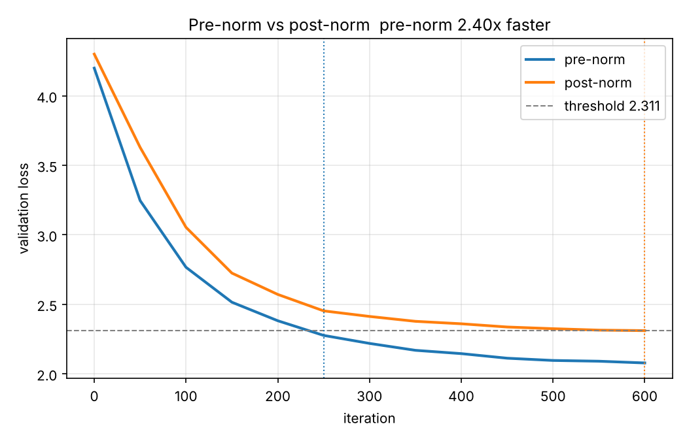

# Decoder-Only Transformer from Scratch

A GPT-style decoder-only transformer implemented in pure PyTorch, with a
controlled ablation on layer normalization placement.

Implemented from first principles: multi-head causal self-attention, rotary
positional embeddings (RoPE), KV caching for inference, and both pre-norm and
post-norm block variants.

## Result

Pre-norm and post-norm models are trained with **identical** parameter counts,
seeds, data order, and learning-rate schedule (linear warmup plus cosine decay).
The only difference is where `LayerNorm` sits.

| | pre-norm | post-norm |
|---|---|---|
| Final validation loss | 2.08 | 2.31 |
| Iterations to reach the shared threshold (val loss 2.31) | 250 | 600 |

**Pre-norm converges 2.4x faster than post-norm** to the same validation loss.



Numbers above come from the config in the "Reproduce" section below; the full
summary is in `results/ablation_summary.json`. The exact speedup depends on
model size and training length (larger, longer runs narrow the gap); the
direction, pre-norm converging faster, is consistent.

### Why the difference

In pre-norm (`x + f(LN(x))`), the residual stream runs from input to output
without passing through any normalization, so gradients flow back through it
unrescaled. In post-norm (`LN(x + f(x))`), every layer renormalizes the main
path, which degrades gradient flow with depth. Both runs use warmup and
gradient clipping, so post-norm is not artificially handicapped.

## Correctness tests

`python scripts/test_model.py` verifies four properties:

1. **Initial loss near ln(vocab_size).** The model starts from a near-uniform
   distribution, confirming initialization and loss are wired correctly.
2. **Causality.** Perturbing token *t* leaves all outputs at positions before
   *t* bit-identical. The causal mask genuinely prevents attending to the
   future.
3. **KV cache equivalence.** Generation with and without the cache produces
   identical token sequences. The cache is an optimization, not an
   approximation.
4. **Matched capacity.** Pre-norm and post-norm models have the same parameter
   count, so the ablation isolates normalization placement alone.

## Setup

```bash
pip install -r requirements.txt
```

## Reproduce

Run the correctness tests:

```bash
python scripts/test_model.py
```

Run the ablation that produces the table above, then plot it:

```bash
python scripts/run_ablation.py --max-iters 600 --n-embd 128 --n-head 4 \
    --n-layer 4 --block-size 64 --eval-interval 50
python scripts/plot_ablation.py
```

Train a model and sample from it, with a KV-cache speed comparison:

```bash
python scripts/generate.py --max-iters 2000
```

Add `--wandb` to any training script to log to Weights & Biases. For a stronger
model (and a smaller, more realistic speedup), scale the ablation up:

```bash
python scripts/run_ablation.py --max-iters 3000 --n-embd 256 --n-layer 6 \
    --block-size 128
```

## Architecture

```
src/rope.py        rotary positional embeddings (build cache, apply rotation)
src/attention.py   multi-head causal self-attention with KV cache; MLP block
src/model.py       transformer blocks (pre/post norm) and the full GPT model
src/train.py       training loop, LR schedule, evaluation, W&B logging
src/data.py        character-level tokenizer and batching
```

Design notes worth knowing:

- **RoPE is applied to queries and keys only**, never to values. Position
  should determine who attends to whom, not the content being transported.
- **Fused QKV projection.** One `nn.Linear` produces all three, then splits.
- **Weight tying** between the token embedding and the output head.
- **Scaled residual init.** Projection weights are initialized with
  `std = 0.02 / sqrt(2 * n_layer)` to keep activation variance stable with
  depth.
- **No weight decay on biases and LayerNorm parameters.**

## Dataset

Tiny Shakespeare (about 1.1 MB), character-level, 65-token vocabulary. Small
enough to iterate on a laptop; the ablation conclusion is about optimization
dynamics, not about this particular corpus.
